# Quantum-Simulator

A state-vector simulator for research, in NumPy with a differentiable JAX
backend. An n-qubit state is a `(2,)*n` complex tensor, so every gate is a
`tensordot` on its target axes and the 2ⁿ × 2ⁿ operator is never built.
Gates, states, observables and partial traces match Qiskit exactly, which
thousands of random circuits check.

## Results

### Barren plateaus come from the entangler's Lie algebra, not the circuit's depth

<picture>
  <source media="(prefers-color-scheme: dark)" srcset="experiments/figures/barren-plateaus-dark.png">
  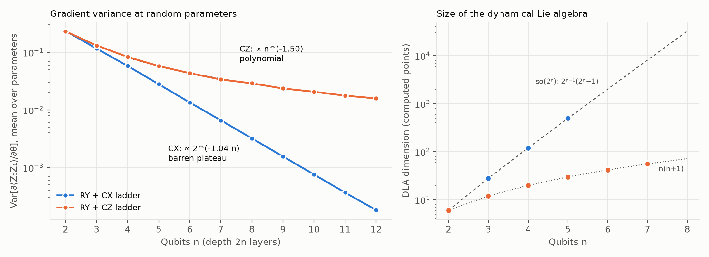
</picture>

Two layered RY ansätze that differ in a single gate behave in opposite
ways. With a CX ladder, the gradient variance at random parameters falls
as 2^(−1.04 n), a barren plateau. With a CZ ladder it falls only as
n^(−1.50). The reason is the ansatz's dynamical Lie algebra, the set of
transformations its parameters can generate. Computed exactly, it is all of
so(2ⁿ) for CX (dimension 6, 28, 120, 496 for n = 2 to 5) but only n(n+1)
for CZ (6, 12, 20, 30, 42, 56 for n = 2 to 7). This matches the theory
relating gradient variance to that algebra's size (Larocca et al., Quantum
2022; Ragone et al., Nat. Commun. 2024). The price of trainability is
expressiveness: the CZ ansatz cannot reach generic states at any depth
(next result). [`experiments/barren_plateaus.py`](experiments/barren_plateaus.py)
regenerates the figure in about 3 minutes.

### The phase transition, and why a finite chain hides its entropy peak

<picture>
  <source media="(prefers-color-scheme: dark)" srcset="experiments/figures/phase-transition-dark.png">
  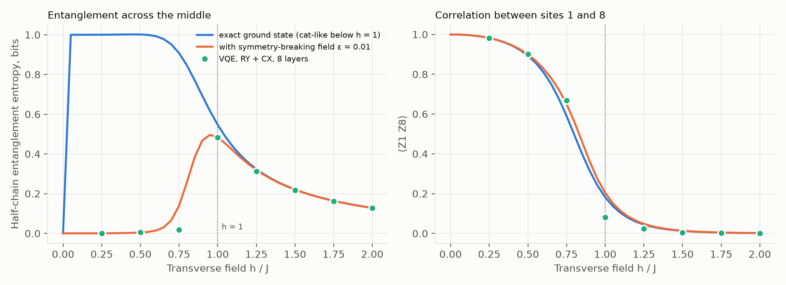
</picture>

Sweeping the field h across the transition on 10 qubits, the correlation
⟨Z₁Z₈⟩ melts from 1 to 0 around h = 1. The half-chain entropy peaks at the
critical point (h = 0.95 on this finite chain), but only once a tiny
symmetry-breaking field (ε = 0.01) is added. Without it, the finite chain's
exact ground state in the ordered phase is a superposition of the two
ordered states, worth one extra bit everywhere below h = 1. That bit hides
the peak entirely: the exact curve's maximum sits at h = 0.45. VQE,
minimizing the plain Hamiltonian, finds the symmetry-broken states on its
own and tracks that curve. Its errors are largest next to the transition
(2–3×10⁻² at h = 0.75 and 1.0, against 6×10⁻⁴ to 4×10⁻³ elsewhere).

<picture>
  <source media="(prefers-color-scheme: dark)" srcset="experiments/figures/correlations-dark.png">
  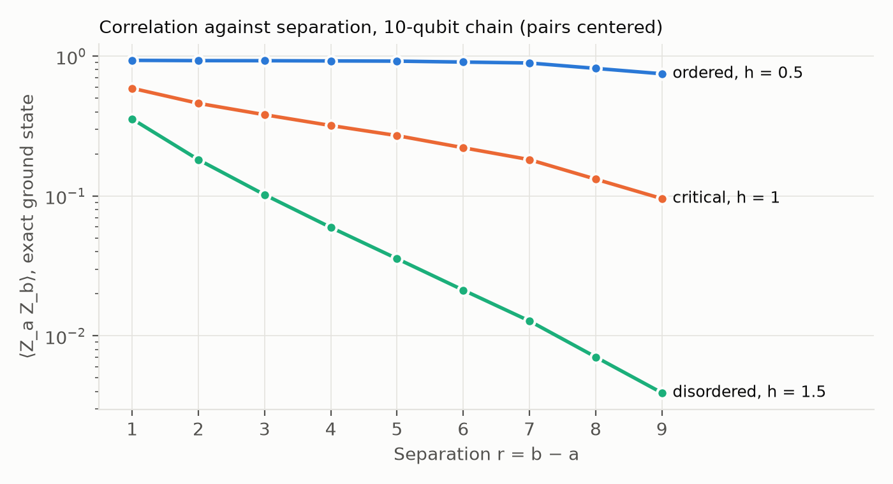
</picture>

The same transition shows in how correlations fall off with distance (exact
ground states, pairs centered on the chain). In the ordered phase ⟨Z_a Z_b⟩
stays near 0.93 at every separation: long-range order. It sags only at the
largest separations, whose sites sit at the chain's ends. In the disordered
phase it falls by a steady factor of about 0.6 per site, which is
exponential decay with a correlation length of about 2 sites. At the
critical point it falls slowly in between, from 0.59 to 0.096 over 9 sites.
[`experiments/phase_transition.py`](experiments/phase_transition.py)
produces both figures in about 8 minutes.

### Why these numbers can be trusted

Every gate, state, observable and partial trace is checked against Qiskit
exactly, including global phases. Hypothesis-generated random circuits
(about 12,000 in one thorough run) are checked against Qiskit and against
two naive full-matrix simulators that share no code with this one. JAX
autodiff agrees with parameter-shift gradients computed on the NumPy
simulator to about 1e-16, and the fast VQE path agrees with the generic
simulator to 1e-12. The MPS, stabilizer and density-matrix backends are
each checked against the dense simulator, and OpenQASM 3 output loads in
Qiskit's importer with identical amplitudes. Bugs were planted in each
module to confirm the tests catch them. Details are in
[How correctness is checked](#how-correctness-is-checked).

### VQE reaches the exact ground state, or a ceiling the Lie algebra predicts

<picture>
  <source media="(prefers-color-scheme: dark)" srcset="experiments/figures/vqe-convergence-dark.png">
  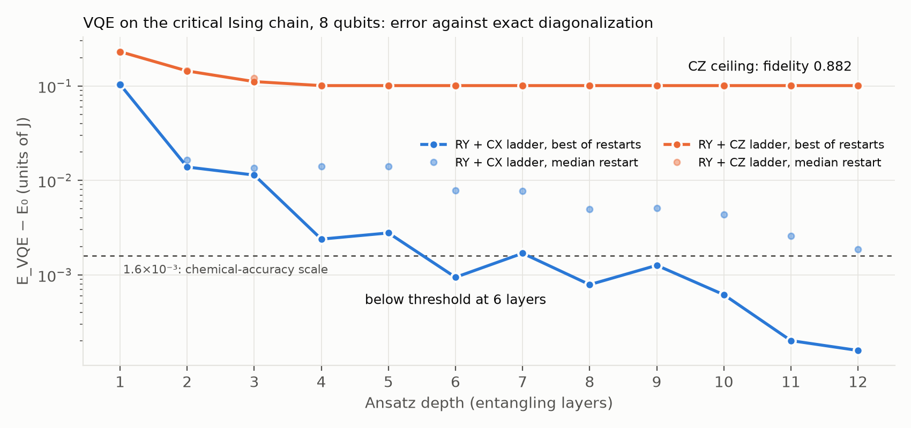
</picture>

On the critical (h = J) open Ising chain of 8 qubits, VQE with the CX
ansatz gets below 1.6×10⁻³ (chemical accuracy's 1.6 mHa carried over to
this model's energy scale) at 6 layers. It reaches 1.6×10⁻⁴ and fidelity
0.99998 with the exact ground state at 12 layers. The best of 16 restarts
does not improve at every single depth (5, 7 and 9 layers come out worse
than the depth before), which is ordinary non-convex optimization showing
through. The CZ ansatz stops at error 0.101 (fidelity 0.882) from 4 layers
on and never improves, as its small Lie algebra predicts.
[`experiments/vqe_convergence.py`](experiments/vqe_convergence.py), about
8 minutes.

## Usage

```python
import numpy as np
from quantum_simulator import State, gates, PauliSum
from quantum_simulator.entanglement import entanglement_entropy

bell = State.zero(2).apply(gates.H, [0]).apply(gates.CX, [0, 1])
entanglement_entropy(bell, [0])                  # 1.0 bit

h = PauliSum([("XX", 1), ("YY", 1), ("ZZ", 1)])
energy, ground = h.ground_state()                # -3.0, the singlet

State.zero(20, dtype=np.complex64).nbytes / 2**20   # 8.0 MiB instead of 16.0

from quantum_simulator import Circuit, run
ansatz = Circuit(2).ry(0).ry(1).cx(0, 1)          # 2 parameters, stored as indices
run(ansatz, params=[0.3, 1.2]).state              # same circuit, any parameter array
```

## Setup

```sh
pip install -e ".[all]"             # the package plus JAX, Qiskit, Hypothesis and matplotlib, pinned
python -m unittest discover         # 325 tests in about a minute
HYPOTHESIS_PROFILE=thorough python -m unittest tests.test_properties   # 2000 random circuits per property
```

`pip install -e .` installs only the simulator and NumPy; the extras are
`jax`, `test` and `plots`, and tests whose optional package is missing skip.
Every dependency is pinned in [`pyproject.toml`](pyproject.toml) to the exact
version the results here were produced with. Each experiment script
regenerates its figures and raw numbers with one command and prints its seed
and environment.

## Conventions

- **Qubit order is Qiskit's (little-endian).** Qubit `t` is bit `t` of the
  flat index, which puts it on tensor axis `n - 1 - t`. Labels read with
  qubit 0 on the right: `"01"` has qubit 0 in `|1>`.
- **Gate matrices are Qiskit's.** For a gate on `qubits`, `qubits[0]` is the
  matrix's least significant bit, so `CX` on `[control, target]` is
  Qiskit's `CXGate` matrix, not the textbook one.
- **Precision is a parameter.** Every state constructor takes `dtype`
  (`complex128` by default, or `complex64`), and every operation preserves
  it. Gates are stored in complex128 and rounded to the state's precision
  when they're applied.
- **Randomness is always explicit.** `measure`, `sample` and `sample_counts`
  require an `rng` (a `numpy.random.Generator` or an int seed). There is no
  default, because an unseeded run can't be reproduced. Measurement treats an
  outcome whose probability is below rounding level for the precision
  (`ZERO_BRANCH_TOL`) as exactly zero, so floating-point noise is never
  selected and blown up into a state.

| Module | Contents |
|---|---|
| `state` | `State`, the index convention, `apply_gate`, precision handling, measurement and sampling |
| `linalg` | inner product, fidelity, unitary/Hermitian checks, `kron` |
| `gates` | standard gates and rotations, `controlled()`, `fuse()`. {H, S, CNOT} generate the Clifford group, which is not universal and, by the Gottesman–Knill theorem, can be simulated classically in polynomial time; adding T makes the set universal |
| `observables` | `PauliSum`: expectation and variance without building the matrix (Z-only terms from probabilities alone), exact diagonalization; `pauli_string`, `z_expectation`, `z_correlation`, `tfim` and its closed-form ground energy |
| `entanglement` | Schmidt decomposition, reduced density matrices, von Neumann/Rényi entropy, entropy across every cut (`entropy_profile`), Page's formula |
| `circuit` | `Op`, `Circuit` (parameters as indices, classical bits, conditions, multi-controlled `mcx`/`mcz`), `run`, DAG, depth, layers, single-qubit gate fusion, `inverse`, `compose` |
| `algorithms` | Bell pair, GHZ, teleportation, Bernstein–Vazirani, Grover, QFT, phase estimation, as circuits |
| `backends.mps` | Matrix product states in mixed canonical form: SVD truncation by bond dimension and cutoff, SWAP routing for distant gates, discarded-weight fidelity estimate, Schmidt values per cut |
| `backends.stabilizer` | Aaronson–Gottesman tableau for Clifford circuits: O(n²) memory, measurement and classical control |
| `backends.density` | Density matrices with Kraus channels (depolarizing, amplitude and phase damping, bit flip), noisy circuits, and pure-state trajectory averaging |
| `vqe` | Layered RY ansatz with a CX or CZ ladder; a fast compiled path (`lax.scan` over layers, real amplitudes, the ladder as one permutation or phase vector), several observables per compilation; Adam; `vqe` with batched restarts; exact dynamical-Lie-algebra dimension |
| `interop` | `to_qiskit` and `from_qiskit`; `to_qasm3` and `from_qasm3` for OpenQASM 3, with exact definitions for the gates outside `stdgates.inc` |
| `backends.jax_backend` | The same simulator as pure JAX functions: `make_state`, `make_energy`, `make_value_and_grad` (compiled, differentiable). Optional; importing it enables JAX's 64-bit mode |
| `gradients` | Exact gradients by the parameter-shift rule on the NumPy simulator: two terms for RX/RY/RZ/RXX/RYY/RZZ/P/CP, four terms for CRX/CRY/CRZ; also finite differences |

## The linear algebra, and where it lives

| Concept | Physical meaning | Implementation |
|---|---|---|
| Complex unit vector | A pure state | `State.psi`, a `(2,)*n` complex array; norm checked on construction |
| Inner product ⟨φ\|ψ⟩ | Overlap, fidelity | `linalg.inner` (`np.vdot`, conjugates the first argument), `linalg.fidelity` |
| Unitary U (U†U = I) | A gate | 2×2 and 4×4 arrays in `gates`; constants are read-only |
| Matrix–vector product | Applying a gate | `state.apply_gate`: `np.tensordot` on the target axes, then `np.moveaxis` |
| Matrix product B·A | Gate A, then gate B | `gates.fuse(A, B)` via `functools.reduce`; arguments in time order |
| Tensor product ⊗ | Combining systems | `State.tensor` (`np.multiply.outer`); `linalg.kron` only for small operators |
| Hermitian H = H† | An observable | `PauliSum` with real coefficients; `linalg.is_hermitian` |
| Eigendecomposition | Energy levels, ground states | `PauliSum.eigh` / `ground_state` (`np.linalg.eigh`, dense, ≤ 12 qubits by default) |
| Singular value decomposition | Schmidt decomposition, entanglement | `entanglement.schmidt_decomposition` (`np.linalg.svd`) |

The only places a 2ⁿ × 2ⁿ matrix is ever built are `PauliSum.to_matrix` and
the exact diagonalization that uses it. Expectation values, variances and
`H|ψ⟩` apply one Pauli at a time to the state tensor, except that terms
made only of Z and I skip gates entirely: their expectation is a signed sum
of probabilities. For a Hermitian observable, an imaginary part above
rounding level raises an error instead of being dropped, because it means
something upstream is wrong.

## How correctness is checked

Each layer of tests checks the code against something that shares no logic
with it:

| Test file | Tests | Checks against |
|---|---|---|
| `test_state.py` | 26 | [`tests/reference.py`](tests/reference.py): naive loops over bit patterns that build full matrices, for gates on adjacent, non-adjacent and reversed qubits |
| `test_linalg.py` | 6 | Definitions: conjugation of the first argument, unitarity, Hermiticity, Kronecker order |
| `test_gates.py` | 11 | Algebraic identities (RX(π) = −iX, SX² = X, HZH = X, …), fusion order, controlled gates |
| `test_standard_gates.py` | 33 | What X, Y, Z, H, S, T, RX, RY, RZ, CNOT and CZ *do*: action on basis states and eigenstates, Pauli algebra, phase-gate powers, rotation laws and Bloch-sphere geometry, CNOT/CZ truth tables, Bell states, phase kickback; state tests run in both precisions |
| `test_measurement.py` | 27 | Collapse against an independent projection over flat indices; Bell and GHZ correlations; Born-rule frequencies; repeated measurement; norm-drift handling; the rounding-noise cutoff in both precisions; required, reproducible `rng` |
| `test_observables.py` | 15 | Known physics: Heisenberg singlet at −3, two-site Ising ground energy −√(1+4g²), zero variance in eigenstates; all 64 three-qubit Pauli strings against Kronecker products; real and complex diagonalization paths |
| `test_expectation.py` | 20 | `pauli_string` labels; the Z-only fast path against applying gates, in both precisions and with gates disabled; a simulated upstream bug tripping the imaginary-part check; ⟨ZᵢZⱼ⟩ on product, GHZ, ordered and disordered states; the TFIM closed form against exact diagonalization |
| `test_entanglement.py` | 23 | Bell and GHZ entropies, product states, a brute-force partial trace; entropy profiles; subadditivity, Araki–Lieb and strong subadditivity on random states; Page's formula against sampled states; area law vs log growth vs volume law on 10-qubit chains; no-cloning via CNOT |
| `test_precision.py` | 12 | complex64 stays complex64 through every operation and agrees with complex128 to single precision |
| `test_circuit.py` | 32 | Building and validation; `run` against applying gates by hand; parameter reuse; classical control; teleportation on all four branches; depth and layers worked out by hand; fusion keeps the state and measurement results, merges in the right order, and never crosses a measurement, condition or two-qubit gate |
| `test_gradients.py` | 18 | JAX autodiff against parameter shifts computed on the NumPy simulator (two independent derivations, two independent simulators), on circuits with every parameterized gate and a shared parameter; shift rules against finite differences and closed forms; the two-term rule shown to fail exactly where it should; JAX states and energies against NumPy in both precisions; one compilation serving many parameter sets |
| `test_qiskit_parity.py` | 27 | Qiskit 2.x, exactly rather than up to global phase: every gate matrix, random circuits (as gate calls and as exported `Circuit`s, fused and unfused), symbolic parameters, circuit depth against Qiskit's `depth()`, probabilities, labels, `pauli_string` and `tfim` against `SparsePauliOp.from_sparse_list`, expectations including the Z-only fast path, `partial_trace`, `entropy`, QFT against `QFTGate`, the algorithm circuits, multi-controlled gates |
| `test_properties.py` | 8 | Hypothesis-generated circuits (every gate kind, up to 6 qubits and 30 ops) against Qiskit and against two naive full-matrix simulators (bit-pattern loops and `np.kron`); norm, fusion, inverse and scheduling invariants; a planted bug shrunk to a minimal circuit |
| `test_algorithms.py` | 23 | Each algorithm's defining property (below), plus `mcx`, `mcz`, `inverse` and `compose` |
| `test_backends.py` | 19 | MPS against the dense simulator (exact without truncation, SWAP routing, Schmidt values, truncation error falling with bond dimension); stabilizer tableau against the dense simulator on random Clifford circuits, GHZ on 1000 qubits, teleportation; density matrices against pure states, channel closed forms, trajectories converging to the density matrix |
| `test_interop.py` | 10 | OpenQASM 3 round trips (exact ops and angles, symbolic parameters, measurement and conditions), Qiskit's importer reading the output with identical amplitudes, `from_qiskit` round trips and hand-built Qiskit circuits |
| `test_vqe.py` | 15 | The fast ansatz path against the NumPy simulator and the generic JAX backend (both entanglers, Pauli strings with Y's, both precisions); its gradient against parameter shifts; Adam against its formula; VQE reaching exact energies; the CZ ceiling not moving with depth; DLA dimensions n(n+1) and so(2ⁿ) |

**Property-based testing.** [`tests/test_properties.py`](tests/test_properties.py)
uses [Hypothesis](https://hypothesis.readthedocs.io) to generate random
circuits and checks each against oracles that share no code with the
simulator: Qiskit, and two naive simulators that multiply full 2ⁿ×2ⁿ
matrices, one built by looping over bit patterns and one with `np.kron`
(I ⊗ … ⊗ U ⊗ … ⊗ I). The naive ones catch the case where this package and
Qiskit share a misunderstanding. Qiskit comparisons
check fidelity, as global phase is unobservable, and also check amplitudes
exactly, which is stricter and possible because the gate definitions match
Qiskit's down to the phase. The default profile runs 100 fixed circuits per
property, so every run tests the same cases. A `thorough` run of 2000
random circuits per property (about 12,000 circuits, 2 minutes) found no
failures.

When a property fails, Hypothesis shrinks the failing circuit. A test
plants the most common bug in a tensor simulator, forgetting the
`moveaxis` after `tensordot`, which leaves the state normalized but wrong.
Hypothesis reduces whatever large circuit it first finds to a single
one-qubit gate on qubit 0 of a two-qubit register, which is the bug in its
smallest form.

**Algorithms as tests.** Each algorithm in
[`quantum_simulator/algorithms.py`](src/quantum_simulator/algorithms.py) has a
property that only holds if every convention is right:

| Algorithm | Exercises | Asserted |
|---|---|---|
| Bell pair | H, CNOT, entanglement | entropy of either qubit is exactly 1 bit |
| GHZ, n = 1–10 | fan-out control | exactly two amplitudes, at 0 and 2ⁿ−1, each 1/√2 |
| Teleportation | mid-circuit measurement, classical control | qubit 2 ends in the input state on all four branches |
| Bernstein–Vazirani | phase kickback | all 32 five-bit secrets recovered with certainty, one oracle query |
| Grover, n = 8 | multi-controlled Z, amplitude amplification | success 0.99995 after ⌊(π/4)√N⌋ = 12 iterations, then falling; matches sin²((2k+1)θ) to 1e-10 |
| QFT, n = 1–5 | controlled phases, qubit order | amplitudes e^{2πijk/N}/√N for every input; equals Qiskit's `QFTGate` |
| Phase estimation | inverse QFT, ancilla register | exact phases m/16 recovered with certainty; others land on the nearest integer with probability ≥ 4/π² |

Grover is worth plotting, because its assertion is a curve. Success peaks
after 12 iterations and then falls as the search over-rotates, which shows
that Grover's algorithm is a rotation in a two-dimensional plane, not a
search that keeps improving:

<picture>
  <source media="(prefers-color-scheme: dark)" srcset="experiments/figures/grover-dark.png">
  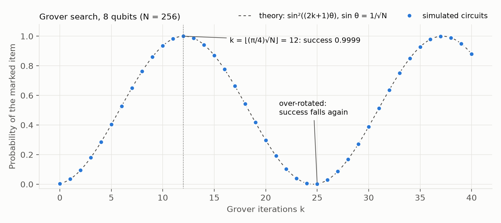
</picture>

Reproduce with `python -m experiments.grover` (a few seconds). Every
simulated point matches the rotation formula to 1e-13.

To confirm the gate tests can actually fail, nine bugs were planted in the
gates one at a time. These included a wrong sign on Y, S swapped for S†,
RX rotating the wrong way, the textbook CNOT ordering, and CZ putting its
phase on the wrong state. Each one made between 5 and 13 tests in
`test_standard_gates.py` fail. Making RZ equal to the phase gate changes it
only by a global phase, which no measurement can see, so only the
matrix-level tests catch that one.

The checks have caught real bugs along the way:

- A `State` built from an eigenvector column kept that column's strided
  memory layout, so `.vector` returned an array Qiskit's native code
  rejects (caught by the Qiskit tests). `State` now stores a contiguous copy.
- Combining a complex64 state with a complex128 one promoted the result to
  complex128 and then checked its norm at complex128 tolerance, which the
  complex64 factor's rounding error fails (caught by the precision tests).
  The check now uses the looser of the two tolerances.
- `np.bitwise_count` returns unsigned 8-bit integers, so the first version
  of the direct Pauli-matrix builder computed a sign of −1 as 255 (caught by
  comparing against Kronecker products; a test now covers all 64
  three-qubit Pauli strings).
- Given a plain Python list of parameters, the JAX gradient came back as a
  list of scalars rather than an array (caught by running the README
  example; a test now covers list input).

## What complex64 costs

A state vector doubles with every qubit, and that ceiling is the same in
any language:

| Qubits | Amplitudes | complex128 | complex64 |
|---|---|---|---|
| 16 | 65,536 | 1 MiB | 512 KiB |
| 20 | 1,048,576 | 16 MiB | 8 MiB |
| 26 | 67,108,864 | 1 GiB | 512 MiB |
| 28 | 2.68 × 10⁸ | 4 GiB | 2 GiB |
| 30 | 1.07 × 10⁹ | 16 GiB | 8 GiB |
| 34 | 1.72 × 10¹⁰ | 256 GiB | 128 GiB |

Halving the bytes per amplitude therefore buys **one** extra qubit at a
fixed memory budget, not twice as many qubits. The question is what that
qubit costs in accuracy, so [`experiments/precision.py`](experiments/precision.py)
measures it on a problem with a known answer.

**Setup.** The periodic transverse-field Ising chain at its critical point,
H = −Σ ZᵢZᵢ₊₁ − Σ Xᵢ. Its ground energy has a closed form,
E₀ = −Σₖ √(2 − 2 cos k) with k = π(2m+1)/n, which the script also checks
against exact diagonalization. Starting from the exact ground state, it
applies L layers of RY/RZ rotations on every qubit plus a CX ring, then
their exact inverse. In exact arithmetic the state comes back to the ground
state, so whatever energy error remains is rounding, accumulated over
6nL gates the way it would be in a long variational loop. Each precision
runs the whole pipeline (state, gates, energy) in that precision. Results
are over 5 random seeds.

<picture>
  <source media="(prefers-color-scheme: dark)" srcset="experiments/figures/precision-dark.png">
  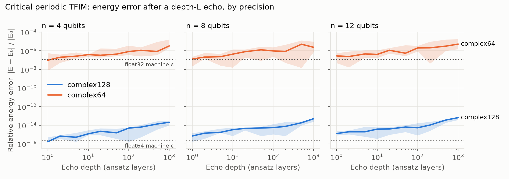
</picture>

*Lines are the median over 5 seeds; bands span min to max. Dotted lines mark
machine epsilon.*

Relative energy error |E − E₀| / |E₀| after a depth-1000 echo (24,000–72,000
gates):

| n | complex64 | complex128 | complex64, renormalized | complex128, renormalized |
|---|---|---|---|---|
| 4 | 3.3e-6 | 2.1e-14 | 4.2e-8 | 1.7e-16 |
| 8 | 2.3e-6 | 5.0e-14 | 4.7e-8 | 1.7e-16 |
| 12 | 5.2e-6 | 6.5e-14 | 5.4e-8 | 3.5e-16 |

Time per single-qubit gate (median of 15; NumPy 2.5.3, one Windows machine):

| n | complex64 | complex128 | speedup | memory (c64 / c128) |
|---|---|---|---|---|
| 20 | 3.8 ms | 6.2 ms | 1.6× | 8 / 16 MiB |
| 22 | 12.5 ms | 21.1 ms | 1.7× | 32 / 64 MiB |
| 24 | 43.9 ms | 84.6 ms | 1.9× | 128 / 256 MiB |

**What this shows:**

1. **complex64 costs about 8 decimal digits of energy accuracy.** Its error
   starts below machine epsilon (2e-8 to 6e-8) and grows to a few parts per million
   after 1,000 layers. Whether that matters depends on the absolute scale:
   chemical accuracy (1.6 mHa) on a molecular total energy of about 100 Ha
   is 1.6e-5 relative. At depth 1000 the median complex64 run meets that
   by a factor of 3–7, but the worst seed at n = 12 (1.8e-5) already misses
   it, and the margin shrinks as circuits get deeper. Renormalizing (item 3)
   restores a wide margin. Raw complex64 is not enough for resolving gaps
   or energy differences below about 1e-5 relative.
2. **The error grows like √L.** The fitted log-log slope of the median
   error against depth is 0.4–0.7 for both precisions. That fits rounding
   errors that add up as a random walk rather than in one direction.
3. **Nearly all of the growth is drift in the norm.** For complex64 the
   relative energy error is almost exactly twice the norm error
   |‖ψ‖ − 1|, as expected since E is quadratic in ψ. Reporting the
   Rayleigh quotient ⟨ψ|H|ψ⟩ / ⟨ψ|ψ⟩ instead of ⟨ψ|H|ψ⟩ brings the depth-1000
   complex64 error below ε (≤ 8e-8, with the norm itself computed in
   float32), at the cost of one extra inner product. **Caveat:** that
   recovery is this large because the echo ends in an eigenstate, where
   errors in the state's direction move the energy only at second order.
   Near a variational minimum, which is where VQE ends up, the same holds.
   Far from one it doesn't.
4. **The speedup is 1.6–2×, growing with n** as the state stops fitting
   in cache. Together with half the memory, that's the gain to set against
   items 1 and 3.
5. **How the energy is evaluated matters too.** Z-only terms are summed
   from probabilities in float64; other terms go through gates and an inner
   product accumulated in the state's precision. Switching the ZZ terms to
   the probability path lowered the renormalized complex64 error at n = 12
   from 2.4e-7 to 5.4e-8, and the depth-0 error from 1.5e-7 to 3e-8, with
   the state evolution unchanged (the norm errors match to every digit).
   Part of complex64's apparent floor was the evaluation, not the state.

Reproduce with `python -m experiments.precision` (about 4 minutes). It
writes the raw numbers to `experiments/results/precision.json` and both
figures, and takes `--sizes`, `--depths`, `--seeds` and `--g`.

## Entanglement: area law, critical log law, volume law

[`experiments/entanglement_scaling.py`](experiments/entanglement_scaling.py)
computes the entanglement entropy S(l) of the first l qubits, for every l,
in exact ground states of the periodic transverse-field Ising chain
H = −Σ ZᵢZᵢ₊₁ − h Σ Xᵢ on 12 qubits, and in 20 random states.

<picture>
  <source media="(prefers-color-scheme: dark)" srcset="experiments/figures/entanglement-scaling-dark.png">
  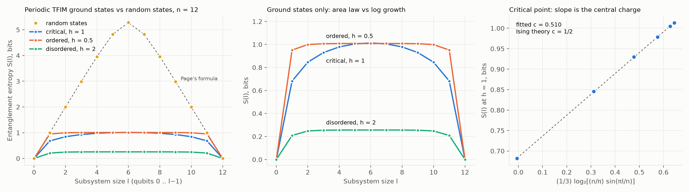
</picture>

| State | S(n/2), bits | What it shows |
|---|---|---|
| Random states (mean of 20) | 5.282 | Volume law: Page's formula predicts 5.279 |
| Ground state, disordered (h = 2) | 0.256 | Area law: levels off after a couple of sites |
| Ground state, ordered (h = 0.5) | 1.008 | Area law: about 1 bit, because the finite-size ground state is a cat-like superposition of the two ordered states |
| Ground state, critical (h = 1) | 1.013 | Grows like log l; the fitted central charge is c = 0.510, against ½ for the Ising universality class |

At the critical point, conformal field theory predicts
S(l) = (c/3) log₂[(n/π) sin(πl/n)] + const for a periodic chain, so S
against that coordinate is a straight line of slope c (right panel). A fit
on 12 qubits recovers c to within 2%. The gapped ground states hold at most
about one bit across any cut, which is why matrix product states can
represent them with small bond dimension, and why random states, at 5.3
bits, cannot be.

Reproduce with `python -m experiments.entanglement_scaling` (about 40
seconds). It prints the seed and environment, writes the raw numbers to
`experiments/results/entanglement_scaling.json`, and takes `--n`,
`--samples` and `--seed`.

**A note on `copy()`.** Nothing in this API clones a qubit. `State.copy()`
exists because the simulator is a classical program holding amplitudes; no
unitary maps |ψ⟩⊗|0⟩ to |ψ⟩⊗|ψ⟩ for every ψ, because linearity forbids it.
The tests show the concrete case: CNOT copies |0⟩ and |1⟩ onto a blank qubit,
so by linearity it must turn |+⟩⊗|0⟩ into a Bell state, which has fidelity ½
with |+⟩⊗|+⟩.

## Gradients: autodiff against the parameter-shift rule

[`jax_backend`](src/quantum_simulator/backends/jax_backend.py) runs the same simulator
as pure JAX functions, so `jax.grad` differentiates the energy with respect
to every circuit parameter at once:

```python
from quantum_simulator import Circuit
from quantum_simulator.backends.jax_backend import make_value_and_grad
from quantum_simulator.observables import tfim

ansatz = Circuit(2).ry(0).ry(1).cx(0, 1)
value_and_grad = make_value_and_grad(ansatz, tfim(2))   # compiled once
energy, gradient = value_and_grad([0.3, 1.2])           # any parameter array
```

Hardware can't backpropagate. It uses the parameter-shift rule instead,
which [`gradients`](src/quantum_simulator/gradients.py) implements on the
NumPy simulator. The tests check one against the other, two independent
derivations on two independent simulators, and they agree to about
1e-16. Two details matter:

- **The two-term rule [f(θ+π/2) − f(θ−π/2)]/2 is exact only for some gates.**
  It holds when the gate's generator has two eigenvalues, as for RX, RY,
  RZ, RXX, RYY, RZZ, P and CP. CRX, CRY and CRZ have generator eigenvalues
  0 and ±½, so the energy has a half-frequency component and needs a
  four-term rule. With H on the control and CRX(θ) onto the target,
  ⟨X_control⟩ = cos(θ/2): the two-term rule gives −sin(θ/2)/√2 instead of
  the correct −sin(θ/2)/2. A test checks exactly this.
- **A parameter shared by several gates** gets one shift per gate, summed.

[`experiments/gradient_cost.py`](experiments/gradient_cost.py) measures
what a gradient costs on 8 qubits as the ansatz deepens, after checking
that all three methods return the same gradient:

<picture>
  <source media="(prefers-color-scheme: dark)" srcset="experiments/figures/gradient-cost-dark.png">
  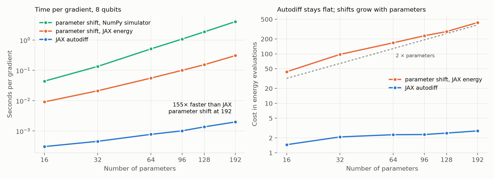
</picture>

| Parameters | One energy | Autodiff gradient | In energies | Shift, JAX | Shift, NumPy |
|---|---|---|---|---|---|
| 16 | 0.21 ms | 0.31 ms | 1.5 | 9 ms (30×) | 0.04 s (144×) |
| 64 | 0.33 ms | 0.77 ms | 2.3 | 56 ms (72×) | 0.51 s (662×) |
| 192 | 0.72 ms | 1.99 ms | 2.8 | 0.31 s (155×) | 4.1 s (2047×) |

The parenthesized factors are how much slower each method is than
autodiff. Autodiff costs 1.5–2.8 energy evaluations at every size: roughly
two forward passes, however many parameters there are. Parameter shift
costs two evaluations per parameter, so the gap grows linearly with the
parameter count.

**The hidden cost: compilation.** `jax.jit` unrolls the
circuit's gate loop when it traces it, and compiling took 14 s at 16
parameters and 31 s at 192 on this machine. It's paid once per circuit
structure, which a long variational loop amortizes, but for a single
gradient it dominates.

Reproduce with `python -m experiments.gradient_cost` (about 4 minutes,
mostly compilation). Timings are from one Windows machine, CPU only.

## Scaling: where Python actually costs time

<picture>
  <source media="(prefers-color-scheme: dark)" srcset="experiments/figures/scaling-dark.png">
  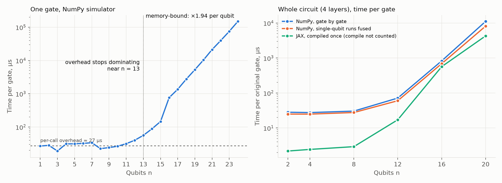
</picture>

NumPy's inner loops are compiled, so on a large state a gate costs what the
memory traffic costs. What Python adds is a fixed cost per call. Measured on
this machine ([`experiments/scaling.py`](experiments/scaling.py)):

- **One gate costs about 27 µs of overhead** up to n ≈ 11, whatever the
  state's size. It passes twice that near **n = 13**, and above n ≈ 16 the
  time grows ×1.94 per qubit: memory-bound. The 5× jump between 15 and 16
  qubits is where the state (1 MiB at 16 qubits) stops fitting in fast cache.
- **Compiling the whole circuit with JAX** removes the per-call cost: 2–3 µs
  per gate against 25–30 µs for NumPy up to 8 qubits (10–13× faster),
  narrowing to 1.5× at 16 qubits and 2.6× at 20, where memory dominates.
  Compiling these circuits took 0.4–4 s.
- **Fusing single-qubit runs** saves 1.1–1.4× here, where each run is only
  two gates.
- **Batching 64 parameter sets with `vmap`** is 2.1× faster than a loop of
  compiled calls (n = 8).
- **complex64** halves memory and was 1.6–2× faster per gate at 20–24
  qubits ([What complex64 costs](#what-complex64-costs)).
- **GPU:** untested. This machine has no GPU; the JAX code needs no changes
  to run on one, but nothing here measures it.

## Other representations, and what each assumes

A dense state vector assumes nothing, which is why it costs 2ⁿ. Each
backend in [`src/quantum_simulator/backends/`](src/quantum_simulator/backends)
buys memory by assuming structure, and each is tested against the dense
simulator:

| Representation | Memory | Per gate | Assumption | Module |
|---|---|---|---|---|
| Dense state vector | O(2ⁿ) | O(2ⁿ) | none | `state` |
| Matrix product state | O(nχ²) | O(χ³) | Schmidt rank ≤ χ at every cut | `backends.mps` |
| Stabilizer tableau | O(n²) | O(n) per gate, O(n²) per measurement | Clifford gates only | `backends.stabilizer` |
| Density matrix | O(4ⁿ) | O(4ⁿ) | none, but represents mixed states | `backends.density` |

**Matrix product states.** On a 16-qubit brickwork circuit of random
rotations and CX gates, an MPS with bond dimension χ = 2ᵏ tracks the dense
state exactly for 2k layers, then loses fidelity
([`experiments/mps_truncation.py`](experiments/mps_truncation.py)):

<picture>
  <source media="(prefers-color-scheme: dark)" srcset="experiments/figures/mps-truncation-dark.png">
  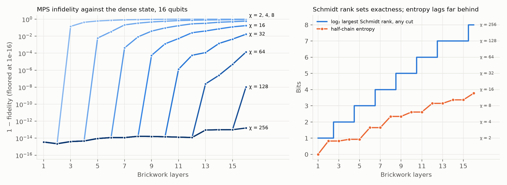
</picture>

What decides exactness is the **Schmidt rank**, not the entanglement
entropy. Every χ loses exactness at precisely the first layer where the
largest Schmidt rank over all cuts exceeds χ. At that point the entropy is
far lower: χ = 2 fails at layer 3 with only 0.82 bits across the middle.
Because truncation then discards small Schmidt coefficients first, the
error grows smoothly: after 16 layers, infidelity is 0.17 at χ = 16, 0.017
at χ = 32, 1.4×10⁻⁴ at χ = 64 and 1.1×10⁻⁸ at χ = 128. The MPS's own
estimate (the product of 1 − discarded weight) tracks the true fidelity,
e.g. 0.8277 against 0.8252 at χ = 16.

**Stabilizer tableau.** By the Gottesman–Knill theorem, Clifford circuits
(H, S, CNOT and Paulis) are classically efficient. The tableau prepares and
measures a 1000-qubit GHZ state in about 0.2 s, where a state vector would
need 2¹⁰⁰⁰ amplitudes. It matches the dense simulator on random Clifford
circuits and runs teleportation, since its corrections are Clifford too.

**Noise: density matrices and trajectories.** A density matrix evolves as
UρU† and passes through noise channels as Σ K ρ K†, at 4ⁿ cost. The
alternative is trajectory averaging: simulate the pure state, pick one Kraus
operator at random after each noisy step, and average
([`experiments/noise.py`](experiments/noise.py)):

<picture>
  <source media="(prefers-color-scheme: dark)" srcset="experiments/figures/noise-dark.png">
  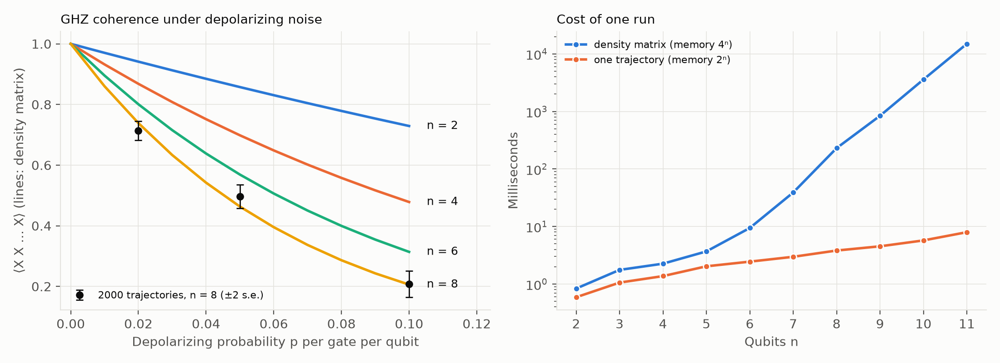
</picture>

GHZ coherence falls faster with more qubits (0.46 at 8 qubits and p = 0.05).
2000 trajectories reproduce the density matrix within 1.7 standard errors.
One density-matrix run grows about 4× per qubit (15 s at 11 qubits), one
trajectory about 1.3× (8 ms), so at the 2000 trajectories needed for a
standard error near 0.02 the two cost the same at about 11 qubits, and
trajectories win beyond.

## Project layout

```text
pyproject.toml          package metadata and pinned dependencies (pip install -e ".[all]")
src/quantum_simulator/
  state.py              State, index convention, apply_gate, precision, measurement
  linalg.py             inner, fidelity, dagger, unitary/Hermitian checks, kron
  gates.py              gate matrices, controlled(), fuse()
  circuit.py            Op, Circuit, run, DAG, fusion, inverse, compose
  observables.py        PauliSum, Z fast path, correlations, TFIM, exact diagonalization
  entanglement.py       Schmidt decomposition, reduced density matrices, entropies, Page's formula
  gradients.py          parameter-shift and finite-difference gradients
  algorithms.py         Bell, GHZ, teleportation, Bernstein-Vazirani, Grover, QFT, phase estimation
  vqe.py                layered ansatz, fast compiled expectations, Adam, VQE, Lie-algebra dimension
  interop.py            to/from Qiskit, to/from OpenQASM 3
  backends/
    jax_backend.py      the dense simulator in JAX: compiled, differentiable
    mps.py              matrix product states
    stabilizer.py       Aaronson-Gottesman tableau
    density.py          density matrices, noise channels, trajectories
tests/
  reference.py          naive full-matrix oracles (bit loops and np.kron) used as ground truth
  strategies.py         Hypothesis strategies for random circuits, and test profiles
  test_*.py             325 tests (see above)
experiments/            each script regenerates its figures and JSON with one command
  barren_plateaus.py    gradient variance and Lie-algebra dimension against qubit count
  phase_transition.py   entanglement and correlations across the Ising transition
  vqe_convergence.py    VQE energy error against ansatz depth (the TFIM VQE)
  mps_truncation.py     MPS error against bond dimension as entanglement grows
  scaling.py            per-call overhead, fusion, JIT and vmap against qubit count
  noise.py              density matrices against trajectories
  precision.py          complex64 vs complex128 energy-error study
  entanglement_scaling.py  area law, critical log law, volume law
  gradient_cost.py      autodiff vs parameter shift, time per gradient
  grover.py             Grover success probability against iterations
  style.py              shared figure palette and axis styling
  results/              raw numbers, one JSON per experiment
  figures/              light and dark PNG per figure
```

## Status and limitations

Done so far:

1. The `(2,)*n` state representation and its qubit-order convention.
2. The linear algebra toolkit: states, gates, fusion, observables, exact
   diagonalization, entanglement.
3. Exact parity with Qiskit, checked by tests.
4. Precision as a parameter, with a measured accuracy and speed cost.
5. Behavior tests for the standard gates (X, Y, Z, H, S, T, RX, RY, RZ,
   CNOT, CZ), with a planted-bug check that they catch real mistakes.
6. Measurement: `prob_one`, `measure` (collapse and renormalize), `sample`
   (one outcome per shot) and `sample_counts`, all with an explicit seed.
7. Circuits as data: `Op` and `Circuit` with parameters stored as indices,
   classical bits and conditioned gates, an executor, a dependency graph
   with depth and layers, single-qubit gate fusion, and `to_qiskit`.
8. Observables: a gate-free fast path for Z-only terms, a hard error when a
   Hermitian expectation comes out complex, ⟨ZᵢZⱼ⟩ correlations,
   `pauli_string`, and a shared `tfim` with its closed-form ground energy.
9. Entanglement diagnostics: entropy across every cut, Page's formula, the
   area-law experiment with a fitted central charge, and the no-cloning
   note on `copy()`. Exact diagonalization got about 8× faster along the
   way (direct Pauli-matrix construction, real arithmetic when possible).
10. Differentiable simulation: a JAX backend with compiled energies and
    autodiff gradients, exact parameter-shift gradients (two- and four-term
    rules) on the NumPy simulator, tests matching the two to about 1e-16,
    and a measured gradient-cost comparison.
11. Validation: property-based tests with Hypothesis against Qiskit and a
    naive full-matrix simulator, a shrinking demonstration, and seven
    algorithms as tests (Bell, GHZ, teleportation, Bernstein–Vazirani,
    Grover, QFT, phase estimation), with multi-controlled gates,
    `Circuit.inverse` and `Circuit.compose` to build them.
12. Variational ground states of the Ising chain: VQE against exact
    diagonalization, the phase-transition sweep, and barren plateaus traced
    to the ansatz's dynamical Lie algebra, with a compiled ansatz path whose
    compile time doesn't grow with depth.
13. Scaling and other representations: per-call overhead, fusion, JIT and
    vmap measured against qubit count; matrix product states with a
    truncation study; a stabilizer tableau; density matrices with noise
    channels and trajectory averaging.
14. Packaging and reproducibility: an installable `src/` package with pinned
    dependencies, a `backends/` package, OpenQASM 3 and Qiskit conversion
    both ways, and every experiment printing its seed and environment.

Not covered yet:

- **The other backends are deliberately minimal.** The MPS handles one- and
  two-qubit gates on a chain (distant gates go through SWAPs) and has no
  canonical-form expectation values or time-evolution algorithms. The
  stabilizer tableau takes Clifford gates only. Noise is a single one-qubit
  channel after every gate, not a device model.
- **GPU untested.** The JAX code should run on a GPU unchanged, but no GPU
  was available, so nothing here measures it.
- **Fusion is single-qubit only.** It merges runs of one-qubit gates but
  doesn't absorb them into a neighbouring two-qubit gate. The scheduler
  treats ops as commuting only when they touch disjoint wires, so it misses
  cases like two diagonal gates on the same qubit.
- **Exact diagonalization is dense**, so it's capped at 12 qubits by default
  (`max_qubits` raises the cap); a 12-qubit ground state takes about 10
  seconds. A sparse or Lanczos solver would go further.
- **Generic JAX compilation time grows with circuit length**, because the
  gate loop is unrolled at trace time (31 s at 192 parameters). The layered
  VQE ansatz avoids this with `jax.lax.scan` and a structure-specific fast
  path, compiling in about 0.3 s at any depth; other circuit shapes don't
  get that yet. The JAX backend differentiates unitary circuits only, with
  no measurement or classical control.
- **VQE uses one ansatz family** (layered RY with a CX or CZ ladder) and
  plain Adam with random restarts. Near the transition on 10 qubits it is
  2–3×10⁻² from the exact energy at 8 layers; deeper circuits, more
  restarts or problem-inspired ansätze would do better there.
- **Tested in one environment:** Python 3.14 on Windows 11, with the
  versions pinned in `pyproject.toml` (NumPy 2.5.3, Qiskit 2.5.2, JAX 0.11.2
  on CPU, Hypothesis 6.169.1, matplotlib 3.11.2). Other Python versions and
  platforms haven't been tried, and there is no CI.
- **The precision study covers one model and one ansatz**, and its timings
  come from one machine. Other Hamiltonians, deeper circuits or
  non-eigenstate targets may behave differently, especially point 3 of its
  findings.
